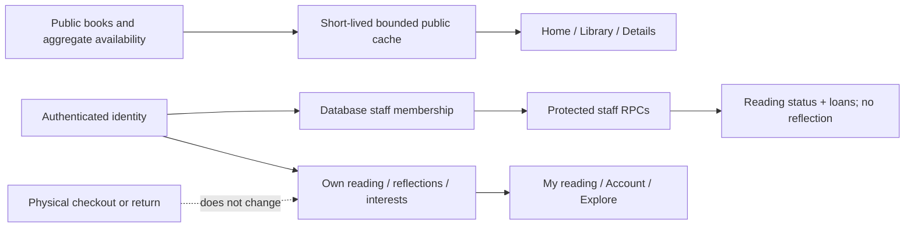

# Design and user-flow review — 7 November 2026

This is the implementation map for the `get-stuff-done-harshith` review branch. It describes code and test contracts, not deployment approval. The integrated release report owns final test totals, commit identifiers, hosted migration state, preview URLs, and remaining release decisions. Existing dated reports remain historical evidence.

The owner expanded this sprint to individual Explore journeys, classroom Together work, teacher support, and redesigned dashboards. Read the detailed additions alongside this foundation map: [Explore](EXPLORE_LEARNING_DESIGN_2026-11-07.md), [Together](TOGETHER_CLASSROOM_DESIGN_2026-11-07.md), [staff teaching workflows](STAFF_TEACHING_2026-11-07.md), and [dashboard design](DASHBOARD_DESIGN_2026-11-07.md). Their database-backed additions are implemented in the branch and remain pending hosted migration deployment.

## Design direction and freely available references

EVG is a bilingual community library for learners and library staff. The primary task is to find a book, understand its language and availability, and continue reading. The owner's final Sorbet palette uses white, soft grey, sage, olive and muted rose, with dark readable text and distinct semantic actions. Local fonts, book covers and nature imagery remain part of the identity. Operational screens prioritize readable records and safe actions.

The supplied reading list is published by [Untitled UI](https://www.untitledui.com/blog/ui-design-books), a maker of Figma resources; it is not a Figma-authored reading list. The sprint consulted the following freely accessible author material. No paid book was reproduced or represented as read in full.

| Reference | Available material used | Application in this branch |
| --- | --- | --- |
| [Refactoring UI, Adam Wathan and Steve Schoger](https://refactoringui.com/) | Public design example and chapter outline; the site also offers free sample chapters | Reduce repeated decorative borders. Help/Privacy now use one reading surface with spacing and dividers instead of a separate box for every paragraph. Hierarchy puts the next useful action ahead of secondary details. |
| [Practical UI, Adham Dannaway](https://www.practical-ui.com/) | Public guidelines on descriptive headings, clear writing, purposeful color, spacing, forms, and button hierarchy; a free preview is linked by the author | Give long support pages a contents navigation. Keep headings descriptive, paragraphs readable, and interface actions explicit. Preserve entered values after failures. |
| [Atomic Design, chapter 2, Brad Frost](https://atomicdesign.bradfrost.com/chapter-2/) | Author-hosted free online chapter | Reuse the same cover/card, controls, typography tokens, and feedback patterns across real pages; validate the assembled page rather than treating a component in isolation as proof of usability. |
| [Inclusive Components: Cards, Heydon Pickering](https://inclusive-components.design/cards/) | Free author-hosted card design article | Give each catalogue card a real title link and a proper heading. Metadata remains separate readable content, while a CSS stretched link preserves a generous click target. Community examples form an explicit list. |

These are design inputs, not a certification. Automated accessibility checks catch a subset of barriers. Keyboard, zoom/reflow, actual devices, assistive technology, and learner/staff usability review remain separate forms of evidence.

### Concrete interface changes

- Home keeps search and the library illustration, but presents the three topics as a compact collection. Book discovery no longer sits behind three full-width scrolling panels.
- Shared navigation supports keyboard dismissal and focus restoration, visible focus, narrow-screen reflow, and header-aware anchor positioning. Motion preferences and forced colors are respected.
- Catalogue and staff catalogue show bounded pages and recoverable loading, empty, and failure states. Browser history preserves filters and pages. Unknown copy counts remain unknown.
- Book-card links announce the title rather than combining title, author, language, availability, and action text into one long link name. Card images advertise the actual 220px cover cap to the browser rather than a potentially much larger viewport fraction.
- Help and Privacy have bilingual in-page contents, focusable section headings, a quiet reading surface, and a clear onward action. Core content remains visible without expanding an accordion.
- Together combines a flexible classroom pathway, activity formats, private notebooks and teacher-reviewed discoveries. The candidate supports publication and moderated feedback; an unchanged hosted backend shows an explicit availability notice until the new migration is applied.
- Reading edits expose unsaved changes and discard behavior. Failed saves preserve the draft; saving or discarding restores a clear state.
- Staff resolution and permission changes show the selected target and requested action before committing. Cancellation performs no mutation.

## Actors and authority

| Actor | Can use | Server authority and exclusions |
| --- | --- | --- |
| Guest | Public home/help/privacy/guide, catalogue and details, Explore resources/activities, Together pathway and approved discoveries/comments | Public projections omit account identities. No private notebooks, reading, account, staff-directory, or lending-record access. |
| Signed-in learner | Guest flows plus own reading, reflections, interests, account/loan summaries, notebooks, deliberate submission/withdrawal, encouragement and moderated comments | Supabase Auth identity plus owner-scoped RLS/RPCs. A learner cannot assign a staff role, read another learner's private records or publish without staff review. |
| Librarian | Learner flows plus catalogue, stock, loan desk, student reading/topic/date summaries, library dashboard, submitted-work review, publication/comment moderation and staff training | Membership in `staff_members`, checked again inside protected database operations. Private reflections and unsubmitted notebooks stay outside staff summaries. No staff-permission administration. |
| Administrator | Librarian flows plus staff role changes and protected circulation-policy configuration | Administrator-only database helpers. The last administrator cannot be removed. The bootstrap path is restricted to the configured approved identity. |
| Programme owner / successor | Operational approval, policy acceptance, support ownership, recovery rehearsal | This is an operating responsibility, not an additional implemented application role. |

There is no implemented cohort, facilitator, moderator, or parent permission role. Those actors in `PLAN.md` belong to the wider roadmap. User-editable Auth metadata supplies display name/language, never staff authority. UI guards improve the experience; PostgreSQL permissions enforce access.

## Implemented use cases and traceability

The S/UC identifiers align with `PLAN.md`. This table covers the foundational use cases; the linked [Together model](TOGETHER_CLASSROOM_DESIGN_2026-11-07.md), [Explore model](EXPLORE_LEARNING_DESIGN_2026-11-07.md) and [staff teaching contracts](STAFF_TEACHING_2026-11-07.md) add this sprint's detailed use cases and regressions. A partial roadmap use case is explicitly split below; presence of a screen does not imply the full roadmap contract is complete.

| System / use case | Actor and route | Main contract, alternatives, and stored result | Implementation and regression coverage |
| --- | --- | --- | --- |
| S01 / UC01 — account entry and recovery | Guest/learner; `/sign-in`, `/reset-password`, `/account` | Register, confirm email, sign in, recover, or sign out of the current tab. Invalid fields are focused. A departed sign-in screen cannot redirect the reader when its delayed request completes. Recovery requires the matching recovery session. | `auth/SignInPage.tsx`, `auth/AccountProvider.tsx`, `auth/validation.ts`; `auth-validation.test.ts`, `session-auth-storage.test.ts`, `auth-resilience.spec.ts`, `tab-auth-isolation.spec.ts`. Invitations remain deferred. |
| S02 / UC02 — find a title | Any visitor; `/`, `/library`, `/library/:bookId` | Search, filter topic, page, inspect language/author/availability, then return to the same filtered results. Empty search can clear filters; unavailable service can retry. Related titles do not block the main detail. | `library/catalogue.ts`, `libraryState.ts`, `LiveLibraryPage.tsx`, `BookDetailPage.tsx`; `release.spec.ts`, `learner-quality.spec.ts`, `navigation.spec.ts`, `request-efficiency.spec.ts`, `supabase/tests/search.sql`. |
| S02 / UC02 — catalogue and physical stock | Librarian/admin; `/staff/catalogue` | Create/edit bilingual metadata and bounded copy counts; search across all pages. Never infer stock after availability fails. Preserve an uncertain cover-save draft without duplicating the committed book. | `admin/BookManagement.tsx`, `catalogueEditorRecovery.ts`; `staff-operations.spec.ts`, `catalogue-save.test.ts`, `supabase/tests/access.sql`, SQL concurrency probes. |
| S03 / UC03 — checkout | Librarian/admin; `/staff/circulation` | Eligible borrower + usable available copy + due date + enabled policy. Backend rejects disabled lending, past dates, excess active loans, or conflicting checkout. Retry-stable IDs prevent duplicate loans. | `circulation/CirculationPage.tsx`, `data.ts`, `validation.ts`; `circulation-validation.test.ts`, `supabase/tests/circulation.sql`, local concurrent-client probes. Physical operation still needs approved policy/inventory. |
| S03 / UC04 — return or loss | Librarian/admin; `/staff/circulation` | Review the exact copy and usable/damaged/lost resolution, cancel or confirm, then refresh availability. A repeated matching operation returns its existing result; conflicting reuse fails. Returning a physical copy does not mark the book finished. | `StaffActionDialog.tsx`, circulation modules; `staff-operations.spec.ts`, `circulation-validation.test.ts`, SQL circulation/concurrency checks. |
| S04 / UC05 — reading and private reflection | Learner; `/library/:bookId`, `/learning` | Add a title; track currently reading or finished; optionally save a reflection of at most 2,000 characters. Failed saves retain text. Discard returns to the saved record. Reopening a finished book does not silently erase its saved reflection. | `learning/reading.ts`, `LiveLearningPage.tsx`; `learner-quality.spec.ts`, `release.spec.ts`, `supabase/tests/reading.sql`. Reading at the centre does not require a physical loan. |
| S04 / UC06, implemented portion — interests | Learner; `/explore` | Select any of three topic interests; save the whole set transactionally. No redundant save for an unchanged set. Load failure and save failure have different recovery paths. | `InterestPicker.tsx`, `reading.ts`; `learner-quality.spec.ts`, `reading.sql`, interest concurrency probes. Goal persistence is not included. |
| S10 / UC06, editorial portion — activities | Any visitor; `/explore` | Open a static activity, inspect materials/steps/reflection prompts, and follow a related book/topic link. No progress or activity completion is persisted. | `ActivityStack.tsx`, `ActivityCard.tsx`; public navigation/release and accessibility journeys. Managed resource authoring and suitability review remain roadmap work. |
| S12 / UC12 — library oversight | Librarian/admin; `/staff`, `/staff/dashboard`, `/staff/students`, `/staff/students/:studentId` | Search/paginate students and loans; inspect current reading titles/status and loan health. Failed borrower lookup has retry; out-of-range pages have a first-page escape. Reflections/interests are excluded from staff reading results. | `admin/staffData.ts`, `StudentsPage.tsx`, `StaffDashboard.tsx`; `staff-operations.spec.ts`, `release.spec.ts`, `staff_oversight.sql`. |
| S12 / UC12 — overdue contact | Librarian/admin; circulation follow-up | Prepare a recipient/subject/body in the operator's email application; separately record that contact occurred. Recording history is idempotent. The website does not send mail or prove delivery/read receipt. | `LoanFollowUp.tsx`, `followUpLogic.ts`, protected contact RPCs; `staff-followup.test.ts`, `staff_oversight.sql`. |
| S01 + S12 / UC12 — staff access | Administrator; `/admin/settings` | Review grant/change/revoke target, confirm, then refresh access. Clear errors cover missing accounts, missing authority, and last-admin protection. | `StaffAccessPanel.tsx`, `staffAccess.ts`, `staffAccessErrors.ts`; `staff-access-errors.test.ts`, `staff-operations.spec.ts`, SQL access/concurrency checks. |
| S12 / UC12 — resilience and operations | Administrator/successor; tools and CI | Build, lint/type checks, unit/browser/SQL tests, bounded error reporting, encrypted backup tooling, isolated restore rehearsal, and release provenance. Unknown deployment state is not silently passed. | `.github/workflows`, `scripts/check-release.ts`, backup/restore tools, `api/client-error.ts`; operations tests and the dated integrated release report. |

`tests/browser/*.spec.ts` uses an intercepted synthetic backend. It proves exercised browser behavior and request contracts, not a new hosted authentication, email-delivery, staff acceptance, or load-test result. SQL suites use a disposable PostgreSQL cluster and an Auth shim unless another report explicitly states real provider services.

## Domain and implementation model

The application is organized by feature, with React functional components, TypeScript data shapes, data-access functions, and SQL contracts. The table below maps the foundational entities; the Together design adds project, comment and encouragement models, while the staff teaching contracts define recorded reading dates and snapshot-protected removal. These models are included in the updated domain source. Framework classes are used where their actual contracts require them.

| Concept | Concrete representation | Ownership and invariant |
| --- | --- | --- |
| Account/session | Supabase `User`; `AccountState`; tab-scoped storage adapter | Auth owns identity; tab storage limits accidental shared-device cross-tab mixing. Staff role comes from the database. |
| Catalogue title | `CatalogueBook`, `NewBook`, `BookUpdate`; `books` | One title record per book, independent of the number/condition of physical copies. |
| Physical copy | `CirculationCopy`; `book_copies` | Unique copy identity/inventory code. Condition and active loans determine availability. |
| Borrower | `Borrower`; `circulation_borrowers` | Existing Auth account registered with library-specific eligibility; a sign-in account alone does not permit borrowing. |
| Lending policy | `CirculationPolicy`; singleton `circulation_policy` | Controls checkout activation, centre timezone, and active-loan limit. Defaults disabled. |
| Loan | `Loan` / staff summary `StaffLoan`; `loans` | A physical copy has at most one active loan; checkout/resolution retries have stable IDs. |
| Circulation event | `circulation_events` | Transactional audit of circulation actions. It is not a general audit log of every UI change. |
| Contact record | `LoanContact`; `loan_contacts` | Staff-only RPC access. Stores operator/name/time/channel; no message body or delivery receipt. |
| Private reading | `ReadingRecord`, `ReadingRecordInput`, `ReadingStatus`; `reading_records` | One row per learner/book. Owner-only direct access; protected staff summaries omit reflections. |
| Interests | `InterestTopic[]`; `learner_interests` | Own selected topic set; replacement is serialized per user. |
| Availability | Aggregate `book_availability` view | Exposes counts without borrower identity; failure produces an unknown state. |
| Public read cache | Bounded in-memory catalogue cache | Brief public snapshots and shared requests only; never private learner records or a replacement for server permissions. |
| Exceptional UI failures | `ErrorBoundary` and `CatalogueCoverSaveError` | Actual classes used where the framework/error contract warrants them; safe recovery without dumping private exception text. |

The updated [domain source](uml/implemented-domain.mmd) includes contact history and the reflection boundary. [Catalogue/reading sequence](uml/catalogue-reading-sequence.mmd), [circulation sequence](uml/circulation-sequence.mmd), and [auth sequence](uml/auth-sequence.mmd) show the implemented responsibilities. The interactive [2 October diagram](uml/rendered.html) is now explicitly marked historical; its original visual/hash remains intact rather than being presented as an up-to-date render.

### Account-independent and account-owned state

A page unmount cancels its subscriber/request where supported. A save preserves its submitted identity and ignores obsolete UI updates. Staff-data change notifications invalidate public availability snapshots and refresh staff summaries. Detailed request quotas, timeouts, cache limits, and hosted activation status belong in the integrated reliability report; a browser cache or throttle alone is not an abuse boundary.

## Main review journeys

Use dedicated synthetic accounts in the isolated test environment for mutating checks. A local UI connected to the real Supabase project writes to that project when an authenticated action is confirmed.

1. **Public discovery:** open Home in English, search, follow a topic, clear an empty search, open a book, then return to its filtered page. Switch to Vietnamese and repeat on a phone-width viewport. Compare content hierarchy, cover fallback, availability wording, and the number of steps to a book.
2. **Support:** open Help/Privacy, use a contents link with a keyboard, verify the destination heading receives focus and sits below the sticky header, then follow the next-step action. Read privacy copy against the actual staff access boundary.
3. **Learner reading:** sign in with a synthetic learner, save a book, mark it finished, add a private reflection, save, and reload. Reopen/discard an edit. Simulate a failed save using the intercepted browser test and confirm that the text survives. Sign out, then use another learner to verify separation.
4. **Staff catalogue:** use a synthetic librarian, search a title beyond the first page, edit metadata/copies, and verify a pending save cannot be replaced by another editor. Simulate missing availability: editing must stay blocked instead of guessing stock.
5. **Circulation:** in the isolated enabled-policy fixture, review a selected copy's return/loss action, cancel, then confirm. Verify that the copy's availability changes and the learner's reading status does not. Repeat the request in database tests to check idempotency.
6. **Staff oversight:** search students, visit a detail page, inspect reading status/loans, and confirm no private reflection appears. Open contact history, review the external email-draft explanation, and keep contact recording separate from sending mail.
7. **Administration:** use the synthetic administrator, review a permission change, cancel, and test protected failure feedback. A learner/librarian must not obtain these controls or authority by changing the URL.
8. **Failure and accessibility:** run the dedicated offline/failure, keyboard, enlarged-text, narrow-width, and accessibility suites. Inspect failure screenshots and retry behavior. Do not infer assistive-technology conformance from automated scans alone.

## Deliberately unshipped capabilities and decisions

- Weekly goal tracking and recognition are still future services. The old `/staff/training` exercises remain fictional. Together now has database-backed notebooks, review, publication, encouragement, and moderated comments in the candidate; hosted activation and real staff/learner acceptance remain pending.
- Groq/DeepSeek or other model providers are not invoked. Explore now uses bounded deterministic topic matching and curated links. A future AI layer still needs suitability review, evaluation, budgets, and a server-owned provider gateway.
- A more complex framework does not make the existing Auth/RLS/contracts reliable automatically. The stack recommendation and costs are a separate operational decision; this sprint preserves the working React/TypeScript/Supabase product while adding measurable safeguards.
- Physical stock, borrower eligibility, lending policy, support ownership, retention, responsible-adult arrangements where appropriate, and staff acceptance require EVG decisions. Tests cannot supply those decisions.
- No main merge, new production deployment, or claim of universal perfection is implied by this document. Review the integrated evidence for exactly what passed and what remains pending.
