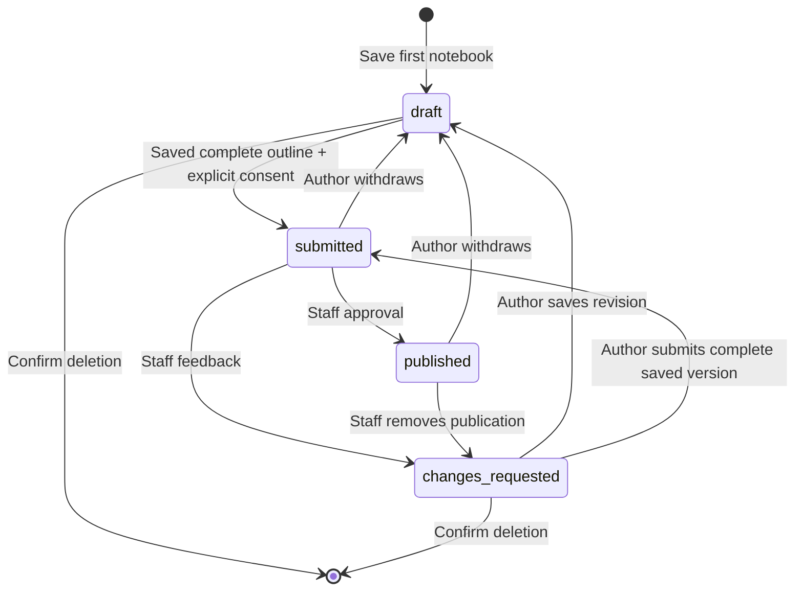

# Together: a reading circle that becomes a shared bookshelf

**Latest presentation update:** The [warm-palette refinement](UI_REFINEMENT_2026-11-07.md) replaces the original long page with activity selection and separate work, bookshelf and teacher-review views. The class plan is optional; a downloadable paper activity remains usable without the new backend. The underlying submission and moderation contracts below remain applicable.

This document records the 7 November 2026 branch implementation. It is a local development candidate, not a hosted release or evidence of a completed EVG student pilot. The project's existing January 2027 learner-rollout gates and staff ownership decisions still apply.

## Audience and purpose

The project serves EVG Vietnam learners and the staff/volunteers supporting them. English and Vietnamese interfaces, shared computers, differing confidence with reading and technology, and uncertain connectivity are relevant design constraints from the repository. Actual student ages, reading levels, device mix and learning outcomes have not been measured here.

The owner's clarification makes the distinction useful:

- **Explore** helps an individual find the next book, topic or learning resource.
- **Together** helps a class turn reading into a discussion, presentation, creation or short written recommendation, then optionally share a reviewed version.

The five-week plan is a proposed classroom format, not a claim that five weeks is the ideal learning duration. Every week can be shortened or extended by staff, and presenting with a partner is explicitly welcome.

## What a learner can do

1. Browse a five-week reading circle without signing in: choose a book, notice something, make an example, rehearse with a partner, then share a discovery.
2. Choose a short book talk, a discovery gallery or a written reader recommendation. Each gives a practical duration, instructions and a prompt. A clean notebook opens in the corresponding format; selecting another prompt never overwrites unsaved writing.
3. Sign in to keep a private notebook. A title and book title are enough to save an unfinished draft. Books brought from home are supported through a plain book-title field; no fake catalogue relation is claimed.
4. Develop an introduction, one to three takeaways, a recommendation and an optional class question. Download a plain text outline for rehearsal or printing from a text editor. Downloads happen only on an explicit action; private drafts are not silently stored in local storage.
5. Save and return later. Errors and rate limits leave the writing in the form; competing edits return a conflict and a download/reload recovery path. A changing user identity remounts the private workspace.
6. Explicitly consent to submitting a saved, complete version for staff review. Submission does not publish. While awaiting review or published, that version is locked; the learner can withdraw it immediately to edit privately again.
7. Read approved discoveries anonymously, encourage another reader once per account (reversible), or send a plain text comment for review. Comments appear publicly only after staff approval.
8. Review and remove their own comments, including comments whose original discovery has been withdrawn. This panel loads only when opened, and it does not reveal private parent titles or contents.
9. Delete a private or returned notebook after a concrete confirmation; cancellation makes no request. Published/submitted work must be withdrawn first.

Unsaved work triggers a browser warning on reload/close and a confirmation when following a link to another page. Save or download before using browser Back or a programmatic navigation: the SPA history cannot currently be blocked through its existing declarative router. Unsaved data is intentionally not retained across account changes.

## Staff workflow

The teacher review desk is inline on Together for authorised staff. It shows submitted/published/returned versions, a staff-only author profile link, and an optional `?student=UUID` filter for projects. Switching that filter remounts the queue so another student's rows cannot linger under the new filter. The comment queue is explicitly labelled as all-classroom comments when the project queue is student-filtered.

The review queue has an explicit refresh action to discover submissions from other sessions. Refreshing with unsent reviewer notes asks before discarding them; cancelling retains the notes and makes no read. Version conflicts link directly to this recovery action. Recording a review updates that item in place, preserving notes on other items.

Before approving a notebook or comment, staff tick a suitability/privacy check. Returning work or rejecting/removing a comment requires a short, specific note. The application stores plain text and never renders learner HTML. Public rows omit author IDs, names and profile links. Staff authorization and state transitions are enforced by database RPCs, independently of visible buttons.

Learner-private drafts remain private from staff. After a returned version is edited and saved, it becomes a private draft again; staff cannot see new unsubmitted changes. Staff may remove a published notebook by returning it for revision. Removing/withdrawing a project hides its public comments, resets approved comments to pending for renewed review and clears encouragements. A later publication does not silently restore prior comment approvals.

## Domain model and state changes

The implementation uses typed records and feature services, matching the existing React application rather than introducing artificial classes.

| Record | Purpose and boundary |
|---|---|
| LearningProject | Owner's book title, title, format and four written prompts; status, staff note and optimistic version |
| PublishedProject | Public text projection, publication timestamp and project ID; no author identity |
| Encouragement | One authenticated reader/project relation; explicit set/unset, never an invented count |
| LearningComment | Plain text of at most 500 characters, owner, parent and review state |
| Review queue projection | Only submitted/published/returned project versions, with staff-only owner context |

Code is split into `CommunityPage`, `ProjectNotebook`, `ProjectConversation`, `MyClassroomComments`, `ProjectReviewDesk`, pure models/copy and small RPC adapters. Model validation is independent from React and repeated at the database boundary. SQL owners/migrations are documented in the overall sprint report.

## Network and storage discipline

- The public bookshelf requests 12 items, with a stable timestamp/ID keyset cursor. It does not fetch all projects.
- Private notebook lists are capped at 25 by the backend. Deletion frees a slot.
- Staff queues page by timestamp/ID, 24 rows at a time.
- Comments and encouragement are fetched only after a public discovery is expanded. Closing and reopening the card preserves the comment draft and does not repeat the read.
- The personal-comment management list is explicit and lazy. It is bounded at 50 comments per author.
- Comments are bounded at five per author/project, 50 per author and 50 per project. This is a product limit as well as a storage-cost control.
- No polling, realtime subscription, uploads, video hosting, social notification service or AI request is added.
- Existing 15-second backend deadline, disabled implicit retries and authenticated mutation budgets apply. Stable reads do not consume the mutation budget.

## Visual and accessibility decisions

The page uses the owner's Sorbet palette with a simple CSS book illustration; no new image request is required. A horizontal five-week line becomes a vertical sequence on phones. Three differently tinted activity blocks provide distinct choices without relying on colour alone. Notebook labels, character limits, plain-language error/status messages and native disclosure/dialog controls support keyboard use.

This applies principles from [Learning Equality's design principles](https://design-system.learningequality.org/principles/): clear defaults, language access, modest device requirements, and support for activity online and offline. Semantic headings and scoped interactive controls draw on the author's freely available [Inclusive Components: Cards](https://inclusive-components.design/cards/). These are design influences, not evidence of student outcomes or an assertion of complete accessibility compliance.

## Verification and review checklist

`tests/together-model.test.ts` covers unfinished-draft rules, publication readiness, all length boundaries, dirty tracking and plain-text downloads. `tests/browser/together-journey.spec.ts` exercises both desktop and phone with synthetic accounts/data: bilingual layouts, unavailable-backend gating, 429 preservation, save/reload, explicit submission/withdrawal, delete cancellation, delayed feedback loading, reversible encouragement, pending comments, idempotent comment retries, staff approval checks, staff author context/filtering, conflicting edits, template safeguards and management of comments on private discoveries. The scenarios include axe scans of public, editing, discussion and staff states. Database ownership/RLS/concurrency and actual HTTP behavior are verified separately by the backend suite; browser mocks alone do not prove those properties.

For the morning walkthrough:

1. Open Together as a guest and inspect the five-week plan and activity formats in both languages.
2. In the synthetic browser suite or a local database with the migration, save a review, reload it, submit and then withdraw it. Confirm it was never publicly visible before approval.
3. As staff, open a student's profile link, review the submitted version, add feedback or approve it, then remove it again.
4. Encourage the published discovery, remove that encouragement and submit a comment. Confirm it is private until reviewed.
5. Switch to a phone width; edit long Vietnamese text, navigate the form by keyboard and cancel a deletion.

Before hosted activation, apply the reviewed migration through the deployment process, verify its live access boundaries with dedicated accounts, confirm moderation ownership and content suitability with EVG, and retain the project's student rollout gates. If the RPCs are absent, the page explains that saved notebooks/sharing are not enabled and offers the usable classroom plan; it does not display a fake Save success or silently persist private content on the device.

### Local verification result

- `node --test tests/together-model.test.ts`: **5 passed**.
- Focused `together-journey.spec.ts` and `public-content.spec.ts`: **22 passed**, covering both configured browser projects. That run included 16 Together checks; a subsequent manual-review-refresh regression adds two checks to the final integrated suite. Shared public-content contributed six.
- Scoped ESLint, `npx tsc -b` and `git diff --check`: passed.
- Focused screenshots and traces: `/private/tmp/healedu-together-third/` (local QA artifacts, not committed).
- An intermediate Together-focused backend run passed 10 SQL suites, 17 concurrency probes and 46 actual PostgREST HTTP checks. The [integrated release report](SPRINT_RELEASE_2026-11-07.md) records the later expanded checks and retained evidence.

The focused browser run used synthetic intercepted responses. It does not prove a hosted deployment, real email/account provisioning, human language quality, screen-reader conformance or educational impact. Staff and Vietnamese-speaking learner review remain part of pilot acceptance.
