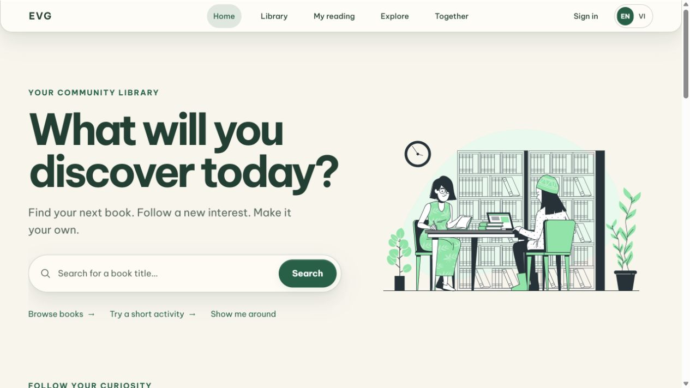
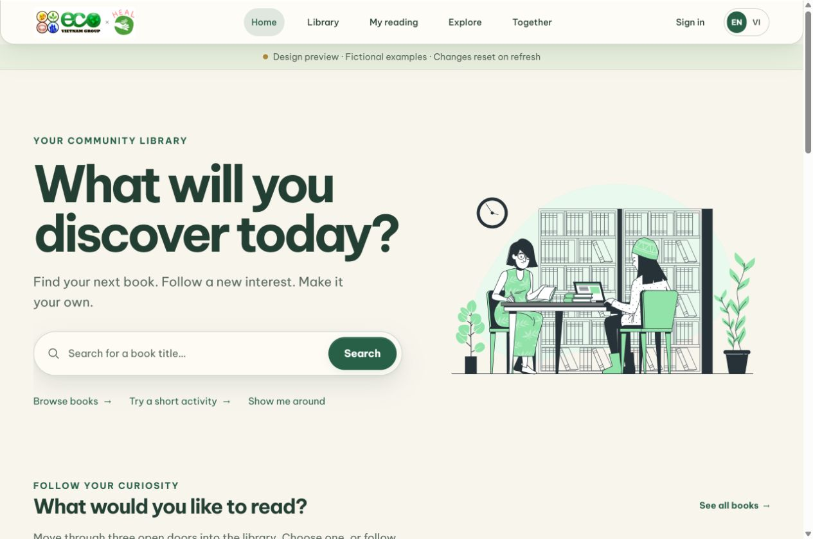
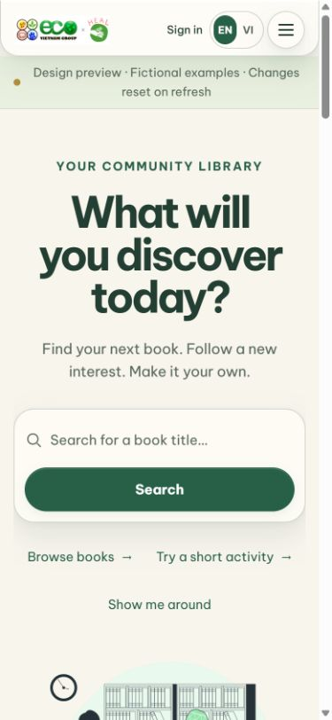

# Website UX review and fixes — 27 November 2026

Reviewed the original `gsharsh/HealEduTech` default branch at `b32e529` and the guest website at https://heal-edu-tech.vercel.app. Changes are proposed for owner review, not deployed. No avatar experiment changes are included.

## Walkthrough and coverage

1. Home: inspected the desktop page, search entry, topic links and navigation. Replaced the top-left EVG text with the approved smaller horizontal EVG × HEAL PNG, arranged side by side without the square badge's circle. It displays at 160 × 48 px on desktop, 112 × 33.6 px on mobile, and 100 × 30 px on narrow phones. The same horizontal asset also appears on sign-in. Both links have descriptive accessible names and explicit image dimensions.
2. Library: exercised hosted search and empty-result guidance, and expanded local regression coverage for loading during same-route URL navigation. Existing automated checks cover filters, book details, deep links, language changes, retry and a failed page download.
3. My reading and accounts: inspected hosted guest entry and blank sign-in validation without submitting credentials. Synthetic browser tests cover saved reading, reload, failed saves preserving text, sign-out, separate tabs, separate learners, and role restrictions.
4. Explore and Together: inspected the hosted activity disclosure, materials and reflection prompts, related-book link, and fictional showcase labelling. Online community submission and rewards remain deferred.
5. Help, Privacy and language: inspected English Help and Vietnamese Help/Privacy at 360px, including language URL changes. Existing browser tests also cover direct Vietnamese URLs, reload and account support links.
6. Staff and administration: reviewed catalogue, circulation, student and dashboard source. Synthetic browser tests cover dashboard/administration access and the new catalogue pagination. Live borrowing, returns, follow-up delivery and student-profile records were not exercised with real accounts.
7. Responsive navigation: inspected the changed header at desktop and 320px; automated checks exercise the menu, logo loading, home link and lack of horizontal overflow at 320px, alongside the existing phone suite.

## Confirmed defects fixed

| Priority | Finding | Change and evidence |
| --- | --- | --- |
| P2 | Staff catalogue fetched only page 0 (24 titles), with no navigation to older records. | Added Previous/Next controls using existing bilingual copy. A 25-book synthetic catalogue verifies both directions and the last-page boundary on desktop and phone. |
| P2 | Library loading was set only by its own form handlers. Same-component URL/history changes could leave previous results or errors visible while another request ran. | Bind results to page, query, topic and retry revision. A delayed-response history-navigation test verifies loading replaces stale cards. |
| P2 | Sign-in recovery/magic-link controls could switch forms while sign-in was pending. Staff catalogue header Add/Cancel actions likewise stayed active during saves. | Disable these conflicting controls while the request is pending. The sign-in regression holds the response and checks both method controls. |
| P2 (Windows development) | Git's automatic CRLF conversion changed the pinned CA file bytes; the baseline test run failed two checksum checks. | A narrow `.gitattributes` rule preserves LF for certificate files. The checksum, DER fingerprint and strict verification implementation are unchanged. All 80 unit tests pass. |

## Screenshots from this review

Hosted home before the change:

Local demo home after the change (the demo banner identifies the disconnected data source):

Local 390px phone header with the approved smaller horizontal logo:

## Validation and remaining limits

- `npm run lint`: passed.
- `npm test`: 80/80 passed after preserving certificate bytes.
- `VITE_APP_MODE=demo npm run build`: passed, including eight pre-rendered public pages and release metadata.
- Browser suite: 34/36 passed in the initial run. The two new pagination cases initially had a fixture-only total-count visibility problem; after exposing the synthetic Content-Range header, the targeted desktop/phone rerun passed 2/2. All 36 distinct cases have passed.
- `git diff --check`: passed.
- Approved horizontal-logo revision: lint and the focused desktop/phone logo-loading, home-link, and 320px navigation checks passed (2/2 browser cases). Updated the screenshots to the approved smaller layout.

This is a route and workflow review, not a claim that every possible state is bug-free or that accessibility compliance is certified. Screenshots establish visual layout, while functional assertions use the repository's synthetic backend. No production writes, migrations, emails or deployments were performed. Real confirmation/recovery email delivery, staff checkout/return scenarios, database policies and recovery operations need separate authorised live verification. The existing public release documentation describes those gates.

## Owner verification

Run the tests and preview this branch, check the approved horizontal logo at actual size, and use a catalogue of at least 25 titles. Review with Vietnamese-speaking staff and learners before release.
